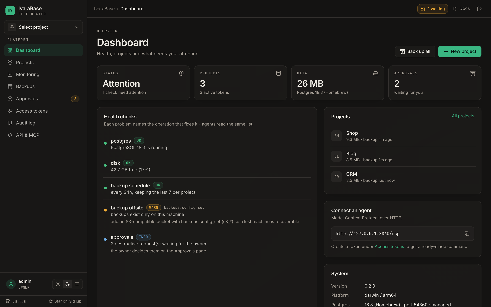
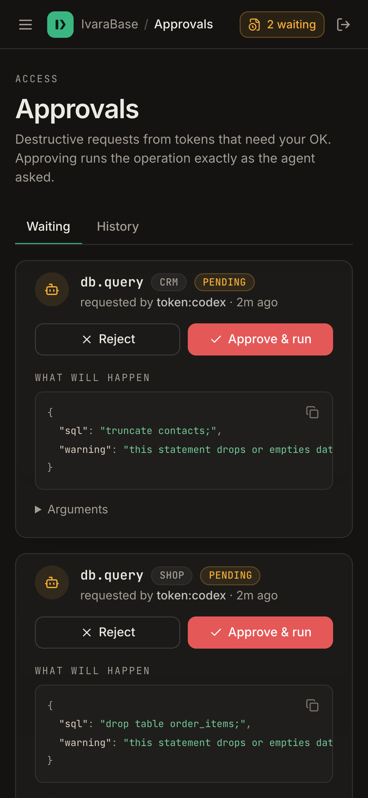
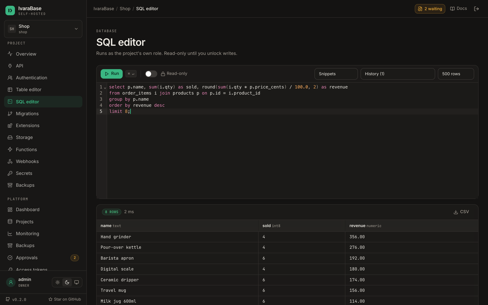
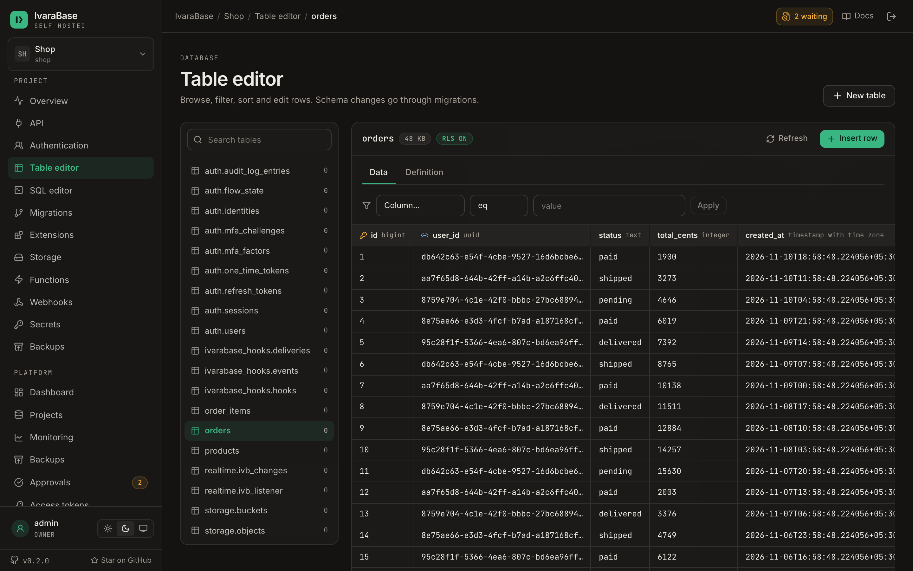
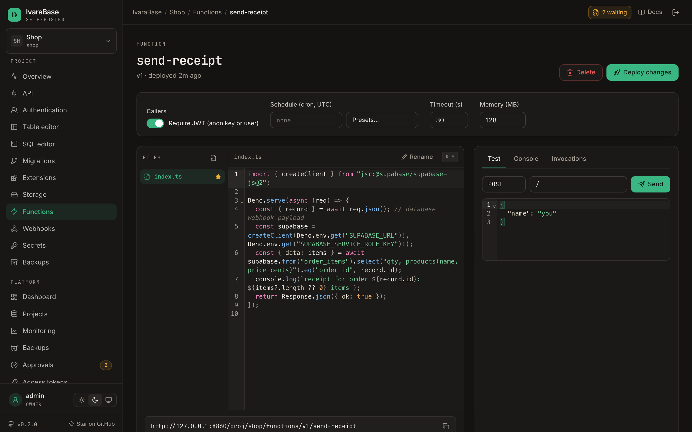
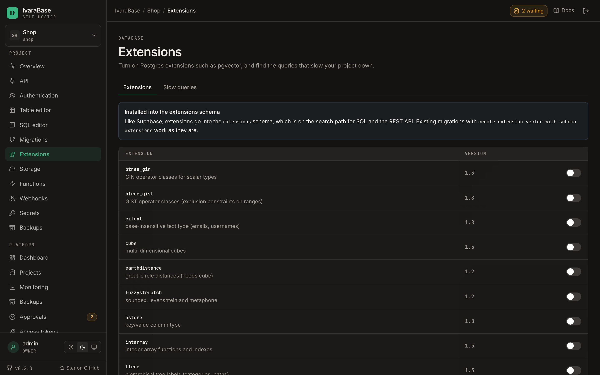
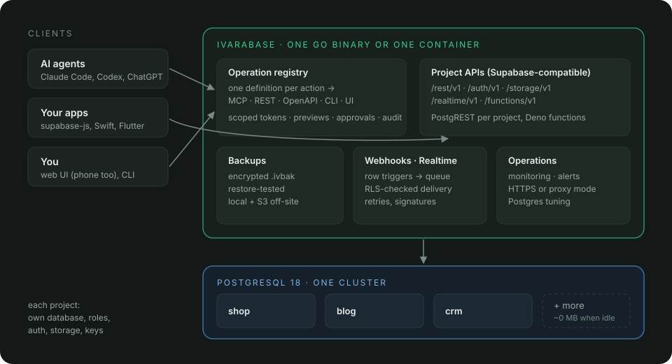

<div align="center">


# IvaraBase

**The self-hosted, Supabase-compatible backend your AI agents can run.**

Many projects on one server. Each one gets Postgres, a REST API, auth, storage, realtime, functions and encrypted backups.<br>
Claude Code, Codex, ChatGPT or any MCP client can build on it, and risky actions wait for your approval.

[](LICENSE)
[](https://github.com/ankittchaurasia/ivarabase/releases)
[](https://github.com/ankittchaurasia/ivarabase/pkgs/container/ivarabase)
[](go.mod)
[](https://github.com/ankittchaurasia/ivarabase/stargazers)

[Quick start](#quick-start) · [Docs](docs/README.md) · [Connect an agent](docs/AGENTS.md) · [Compare](docs/COMPARISON.md) · [Discussions](https://github.com/ankittchaurasia/ivarabase/discussions)

<br>

<picture>
  <source media="(prefers-color-scheme: light)" srcset="docs/images/dashboard-light.png">
  
</picture>

</div>

## Why IvaraBase

- **🤖 Agents run it.** Every action is an *operation* in one registry, and the web UI, REST API, OpenAPI spec, CLI and **MCP server** all come from it. Nothing is UI-only, so an agent can do everything you can: create projects, write migrations, deploy functions, set up auth, restore backups.
- **🛡️ Safe by design.** Tokens are scoped by level, project and expiry. Destructive calls show a preview first. From an agent, they become **approval requests** you accept or reject, from your phone too. Every change is in the audit log.
- **📦 Many projects, no extra cost.** A project is a database, a few roles and some metadata in one Postgres cluster, and it idles at about 0 MB. Ten side projects run on the server you already pay for.
- **🔌 Supabase-compatible.** Point `supabase-js` at a project and it works: queries with RLS, `auth.*`, `storage.*`, `channel()`, `functions.invoke()`. [Compatibility details](docs/SUPABASE.md).
- **💾 Backups you can trust.** Encrypted bundles, restore-tested automatically, copied off-site to any S3 bucket, with a one-command rebuild on a new machine.
- **🪶 Light and yours.** One Go binary or one container, on your VPS or Mac. No telemetry and no outside services.

## How it compares

|  | **IvaraBase** | Supabase (self-hosted) | PocketBase | Firebase |
|---|:---:|:---:|:---:|:---:|
| Built to be run by AI agents (MCP, approvals) | ✅ | ⚠️ separate MCP server | ❌ | ⚠️ separate MCP server |
| Many projects on one server | ✅ ~0 MB each | ❌ one stack per project | ❌ one app per process | ☁️ cloud only |
| Install | ✅ 1 container | ⚠️ ~12 containers | ✅ 1 binary | ❌ not self-hostable |
| Database | Postgres 18 | Postgres | SQLite | Firestore (NoSQL) |
| `supabase-js` works | ✅ | ✅ | ❌ | ❌ |
| Auth: email, phone, OAuth/OIDC, MFA, anonymous | ✅ | ✅ | ⚠️ no phone | ✅ |
| Realtime, storage, functions | ✅ | ✅ | ⚠️ JS hooks | ✅ |
| Vector search (pgvector) | ✅ | ✅ | ❌ | ✅ |
| Encrypted, restore-tested backups | ✅ built in | ⚠️ do it yourself | ⚠️ unencrypted zips | ☁️ paid add-on |
| License | AGPL-3.0 | Apache-2.0 | MIT | Proprietary |

Supabase and Firebase have bigger ecosystems and managed hosting; IvaraBase is young. [Full comparison and when to pick which](docs/COMPARISON.md).

## What's in a project

| | |
|---|---|
| **Database** | Postgres 18, SQL editor, table editor, tracked migrations, TypeScript types, extensions (**pgvector**, PostGIS, pg_trgm…), slow queries |
| **REST API** | `/rest/v1` via PostgREST: filters, embedding, RPC, upsert, row level security |
| **Auth** | Email and password, magic links, **phone (SMS)**, **anonymous users**, **MFA (TOTP)**, Google, GitHub, Apple, **any OpenID Connect provider** |
| **Storage** | Buckets with RLS, signed URLs, **resumable uploads (TUS)**, local disk or S3/R2/B2 |
| **Realtime** | Postgres changes (RLS-aware), broadcast and presence over `supabase.channel()` |
| **Functions** | TypeScript on Deno (`Deno.serve`), secrets, cron schedules, logs |
| **Webhooks** | Call a URL or a function on insert, update or delete, with retries and signatures |
| **Backups** | Encrypted bundles, schedules, restore tests, off-site S3, disaster recovery |
| **Operations** | Monitoring and alerts, automatic HTTPS or proxy mode, Postgres tuning |

## Quick start

### Docker (recommended)

```sh
curl -fsSLO https://raw.githubusercontent.com/ankittchaurasia/ivarabase/main/docker-compose.yml
docker compose up -d
docker exec ivarabase cat /data/secrets/INITIAL_CREDENTIALS.txt   # login + recovery key
```

Open http://127.0.0.1:8787. **Save the recovery key in a password manager**: it decrypts your backups.

For a server, set `IVARA_DOMAIN` in the compose file and point your reverse proxy (nginx, Caddy, Traefik) at `127.0.0.1:8787`. See the [Docker guide](docs/DOCKER.md).

### Without Docker

Download a binary from [Releases](https://github.com/ankittchaurasia/ivarabase/releases) (Linux and macOS, amd64 and arm64), install the dependencies and start it:

```sh
sudo bash scripts/install-deps-ubuntu.sh   # Ubuntu/Debian: PostgreSQL 18, PostgREST, Deno, pgvector
# macOS: brew install postgresql@18 postgrest deno pgvector
ivarabase serve                            # first run prints the login and recovery key
```

Production setup with automatic HTTPS: [docs/DEPLOY.md](docs/DEPLOY.md).

## Connect an AI agent

Create a token under **Access tokens**, then add the server to your agent:

```sh
claude mcp add --transport http ivarabase https://base.example.com/mcp \
  --header "Authorization: Bearer ivb_..."
```

Codex, ChatGPT, Cursor, VS Code and Claude Desktop are covered in [docs/AGENTS.md](docs/AGENTS.md). Then ask something like:

> *Create a project called shop with products and orders, RLS so users only see their own orders, and a function that emails a receipt when an order is placed.*

When the agent tries something destructive, you get an approval request:

<p align="center">
  
</p>

## Use it from your app

```ts
import { createClient } from "@supabase/supabase-js";

const supabase = createClient("https://shop.base.example.com", "<anon key>");

const { data: orders } = await supabase
  .from("orders")
  .select("id, total_cents, order_items(qty, products(name))")
  .order("created_at", { ascending: false });

supabase
  .channel("orders")
  .on("postgres_changes", { event: "INSERT", schema: "public", table: "orders" }, (p) => console.log(p.new))
  .subscribe();
```

## Screenshots

| | |
|:---:|:---:|
| <br>SQL editor | <br>Table editor |
| <br>Functions | <br>Extensions |

## How it works

<p align="center">
  
</p>

One Go binary serves the UI, the APIs and MCP, and supervises Postgres, a PostgREST process per project, and Deno for functions. Details in [docs/ARCHITECTURE.md](docs/ARCHITECTURE.md).

## Documentation

| Get started | Guides | Reference |
|---|---|---|
| [Install with Docker](docs/DOCKER.md) | [AI agents & MCP](docs/AGENTS.md) | [Configuration](docs/CONFIGURATION.md) |
| [Install without Docker](docs/DEPLOY.md) | [Database & extensions](docs/DATABASE.md) | [Config as code](docs/CONFIG-AS-CODE.md) |
| [Behind a reverse proxy](docs/PROXY.md) | [Auth](docs/AUTH.md) · [Apple](docs/APPLE.md) | [Supabase compatibility](docs/SUPABASE.md) |
| [Upgrading](docs/UPGRADING.md) | [Storage](docs/STORAGE.md) · [Realtime](docs/REALTIME.md) | [Comparison](docs/COMPARISON.md) |
| | [Functions](docs/FUNCTIONS.md) · [Webhooks](docs/WEBHOOKS.md) | [Architecture](docs/ARCHITECTURE.md) |
| | [Backups](docs/BACKUPS.md) | [Roadmap](docs/ROADMAP.md) |

## Status

**v0.2**, the first public release. It runs real projects, and every release passes end-to-end suites with the real `supabase-js`, `tus-js-client` and Apple sign-in flows (`make selftest`, about 300 checks). It's still young: keep backups, and please [report what breaks](https://github.com/ankittchaurasia/ivarabase/issues).

Not included: GraphQL, point-in-time recovery, branching and read replicas. See the [roadmap](docs/ROADMAP.md).

## Contributing

Issues, ideas and pull requests are welcome; see [CONTRIBUTING.md](CONTRIBUTING.md). Questions go to [Discussions](https://github.com/ankittchaurasia/ivarabase/discussions), and security reports go through [private reporting](SECURITY.md).

If IvaraBase is useful to you, a ⭐ helps other people find it.

## License

[AGPL-3.0](LICENSE). Use it, modify it and self-host it freely, commercially too. If you offer a modified IvaraBase to others as a network service, the AGPL asks you to share your changes. A **commercial license** without these terms is available; see [LICENSING.md](LICENSING.md).
